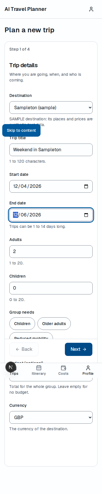
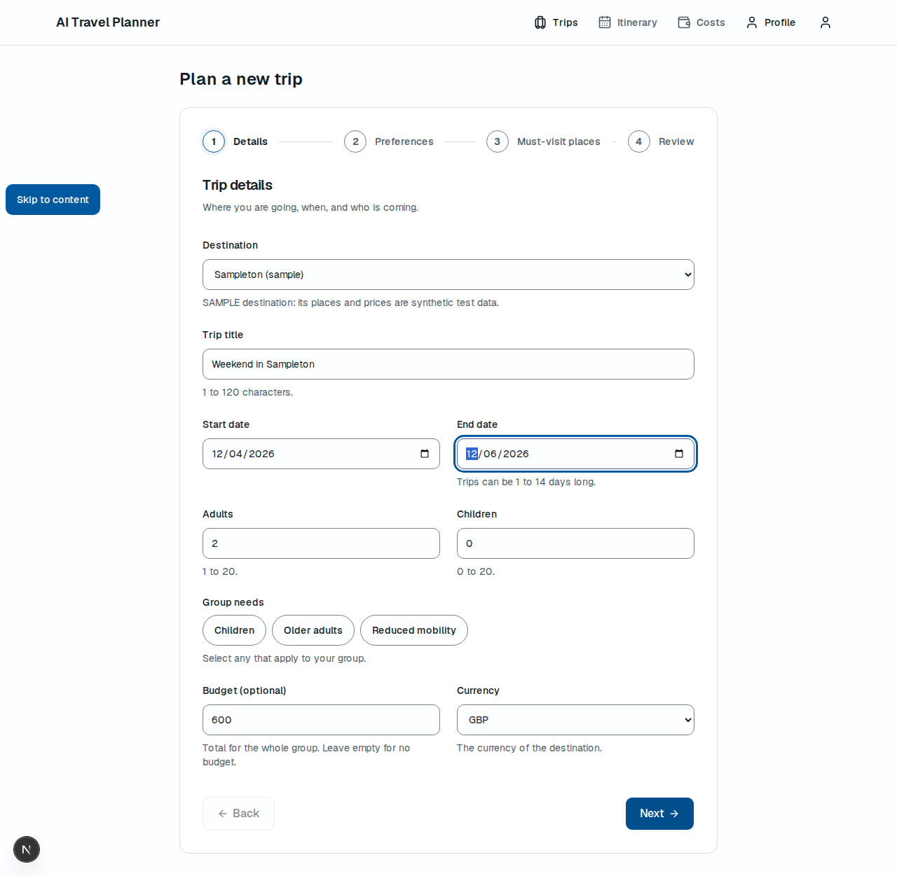
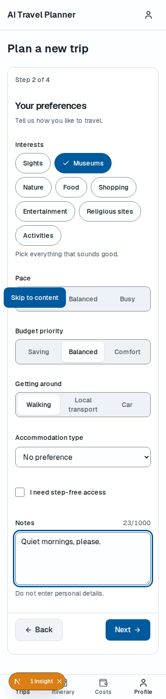
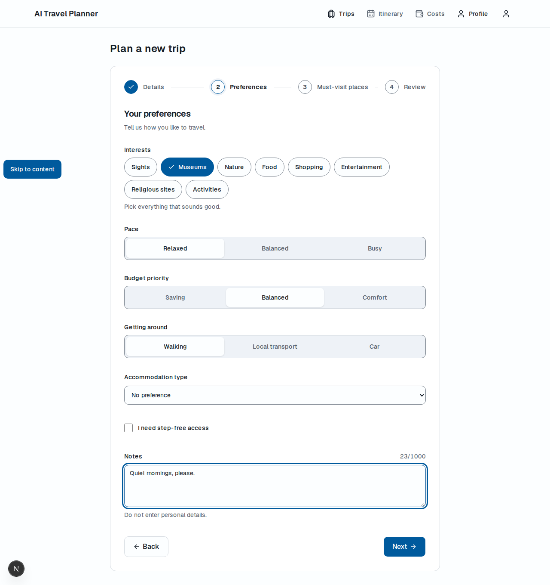
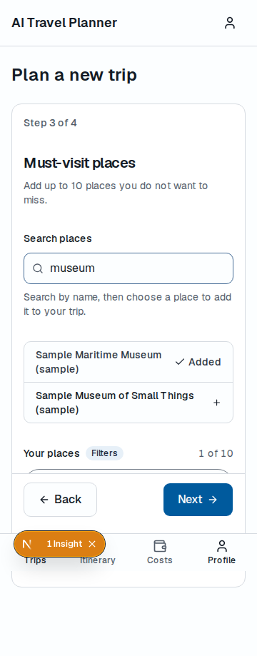
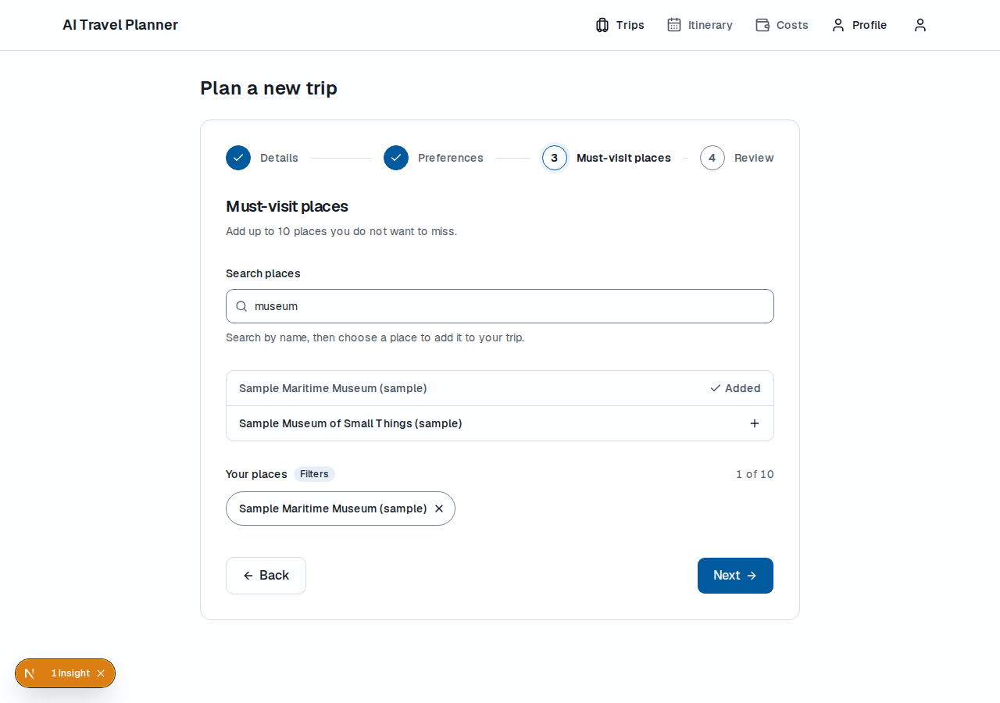
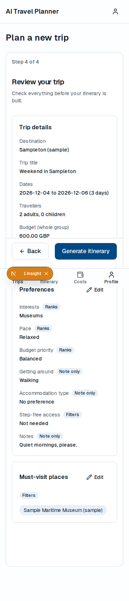
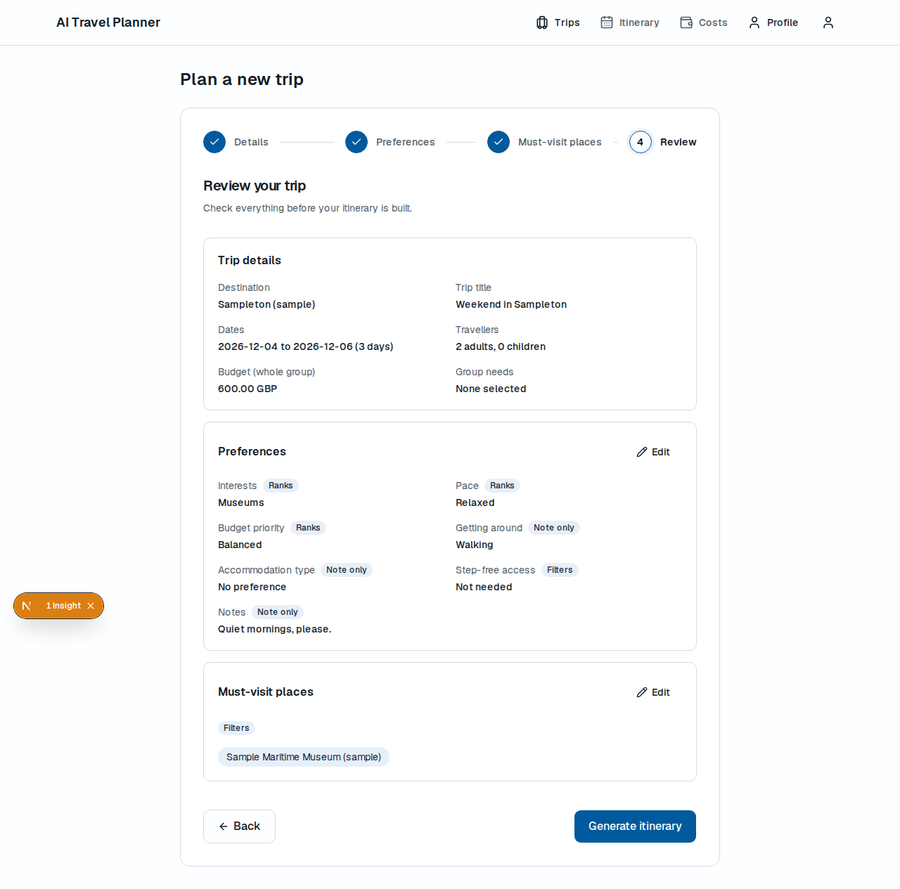

# IMP-212 · whole-task part

- Run id: RUN-033
- Owner: Manasvi (Manasvi1704)
- Status: PR_OPEN
- Base commit: b4af4d0
- Branch: feat/IMP-212-whole-task
- Reviewer: Krrish (Assassin-byte)
- Traces to: US-016, US-017; FR-007, FR-008, FR-009; NFR-025; TC-068 to TC-076
- Card steps built: 1 to 5, narrowed by §7.5.4 (four steps, each saved before the next; see the proposed decisions)

## Changed files

Card files:

- `apps/web/app/(app)/trips/new/page.tsx` (created): thin server route that renders `TripWizard` (§7.1).
- `apps/web/components/trips/TripWizard.tsx` (created): the four steps (Details, Preferences, Must-visit places, Review).
  - Details creates the draft trip with API-07. Preferences and Must-visit places each save with API-14, and the next step opens only after a 2xx.
  - Every API-14 body is a full replacement that carries the other step's saved values.
  - Focus moves to the step heading on each step change.
  - A 422 with details is handed back to the step's form. Any other error shows `ErrorState` inline with the request ID, and the forms stay mounted, so the input is kept. A network failure shows an offline message.
  - On phones the stepper reads "Step N of 4" and Back/Next stick above the bottom navigation.
  - The review step links to `/trips/{id}/generate`.
- `apps/web/components/trips/PreferenceForm.tsx` (created): interests, pace, budget priority, transport, accommodation type, step-free access, and notes with the hint "Do not enter personal details" and a counter.
  - The form starts from API-15, which returns the defaults before anything is saved.
  - Once API-15 reports `saved: true`, each field shows "Filters", "Ranks" or "Note only" from `effects` (`effectsOf`).
- `apps/web/lib/validation/trip.ts` (created): zod schemas that mirror §6.5 and `trips/domain.py`:
  - title 1 to 120 characters;
  - end date on or after start date, 1 to 14 days;
  - adults 1 to 20, children 0 to 20;
  - budget optional; when given, amount greater than 0 with at most 10 digits before the point and 2 after, and a three-letter currency;
  - notes at most 1,000 characters; at most 10 must-visit places.

  It also holds:
  - display labels for every enum, each typed `Record<generated enum, string>`, so a change to the contract fails `make typecheck`;
  - `toTripIn`, which sends `budget: null` when the amount is empty;
  - `fieldErrors`, which maps server `details[].field` onto form fields (`budget.amount`, and `interests.0` to `interests`), and the rest onto the form root.
- `apps/web/tests/unit/trips/TripWizard.test.tsx` (created): 10 tests against an in-memory SAMPLE API.
- `apps/web/e2e/trip-create.spec.ts` (created): sign in, fill the four steps against the local stack, land on the generate page. `UPDATE_SCREENSHOTS=1` writes the screenshots below at 360 and 1280 px.

Extra presentational components (allowed by the run; ported from the draft's layout):

- `apps/web/components/trips/TripStepper.tsx`: "Step N of 4" on phones, named steps from 768 px.
- `apps/web/components/trips/TripDetailsStep.tsx`: step 1 form.
  - Destinations come from API-06 (LoadingSkeleton while loading, ErrorState with retry on failure), with a SAMPLE note when `is_sample` is true.
  - Group needs are chips.
  - The budget is labelled as the total for the whole group. The currency option is the chosen destination's currency from API-06.
  - The fields are read-only once the trip exists (see the open issues).
- `apps/web/components/trips/PlacesStep.tsx`: API-16 search (300 ms debounce, `q` at most 80 characters), add and remove chips, a limit of 10, loading, empty and error states.
- `apps/web/components/trips/ReviewStep.tsx`: the saved trip (API-07 response) and preferences (API-15). Dates and amounts are shown as received, the day count is `num_days`, and effect badges are shown. Preferences and Must-visit places have Edit links.
- `apps/web/components/trips/Field.tsx`: label, hint, error and effect badge. The error sits in an `aria-live` region and is linked with `aria-describedby`. `CONTROL_CLASS` gives native selects and textareas the look of the Input.
- `apps/web/components/trips/ChipMultiSelect.tsx`: 44 px toggle chips with `aria-pressed`.
- `apps/web/components/trips/SegmentedChoice.tsx`: native radios shown as segments, so arrow keys change the choice.

Outside the card's Files list:

- `apps/web/lib/api/queries.ts` (modified). It gains the keys `destinations`, `preferences` and `places`, and the hooks `useDestinations` (API-06), `usePreferences` (API-15), `usePlaceSearch` (API-16), `useCreateTrip` (API-07: invalidates `trips`) and `useSavePreferences` (API-14: sets and invalidates `preferences`, invalidates `trip`). §7.1 says that all hooks and query keys live in this file, and §7.4 sets the invalidations (see PD-IMP-212-3).

Evidence: `docs/progress/parts/IMP-212-screens/` holds eight screenshots: `1-details`, `2-preferences`, `3-places` and `4-review`, each at 360 and 1280 px.

No API, contract, migration, backend or environment file changed. No new dependency was added.

## Screens

| Step | 360 px | 1280 px |
| --- | --- | --- |
| Details |  |  |
| Preferences |  |  |
| Must-visit places |  |  |
| Review |  |  |

These are full-page captures, so fixed elements are drawn where the viewport was: the bottom navigation, the sticky Back/Next bar, the skip link and the Next.js dev badge.

## Checks that the tests can fail

- `fieldErrors` was changed to send every server detail to the form root, then reverted. `npx vitest run tests/unit/trips` printed `× FR-008 AC1: the server's 422 is mapped onto the same field and the input is kept` and `Tests  1 failed | 9 passed (10)`. After the revert it printed `Tests  10 passed (10)`.

## Commands run

`make db-up` was run before `make check`, then `make db-down`. The e2e run used the local stack:
- `make stack-up`, `make db-migrate`, `make seed`;
- the API on port 8000 with `AI_PROVIDER=MOCK`;
- the stack's URL and keys exported from `supabase status -o env` into the environment of each command only. No key was printed or written to a file, and `apps/api/.env` and `apps/web/.env.local` were not read.

`make stack-down` was run at the end.

| Command | Result |
| --- | --- |
| `make test-web ARGS='TripWizard'` | `Test Files  1 passed (1)`, `Tests  10 passed (10)` |
| `make e2e ARGS='trip-create'` (first run) | 4 failed: API-06 answered 401. This Supabase CLI (v2.122.0) signs tokens with asymmetric keys, so the API needs `SUPABASE_JWKS_URL` (environment only, no code change) |
| `make e2e ARGS='trip-create'` (second run) | 4 failed: `getByRole('button', { name: 'Next' })` also matched "Open Next.js Dev Tools"; the locator now uses `exact: true` |
| `make e2e ARGS='trip-create'` | `4 passed (11.6s)` (360, 768, 1280 and 1920 px) |
| `UPDATE_SCREENSHOTS=1 make e2e ARGS='trip-create'` | `4 passed (9.6s)`; 8 screenshots written |
| `make seed` (local stack) | `seed sampleton: places inserted 0, updated 0, unchanged 30, deactivated 0` |
| `make check` | exit 0. Lint: `All checks passed!`, `138 files already formatted`, `✖ 1 problem (0 errors, 1 warning)` (the existing `window.location.assign` warning in `lib/api/client.ts`, IMP-214), `All matched files use Prettier code style!`. Types: `Success: no issues found in 85 source files`, `✓ Types generated successfully`. Imports: `Contracts: 4 kept, 0 broken.`. Contract: `openapi-check: contracts/ and apps/web/lib/api/schema.d.ts are up to date`. Tests: unit `385 passed, 1 warning in 10.18s`, contract `35 passed, 1 warning in 1.00s`, api `223 passed, 1 warning in 65.65s (0:01:05)`, authz `25 passed in 15.02s`, web `Test Files  11 passed (11)`, `Tests  64 passed (64)` |

## Not run

- An automated accessibility scan (axe) for NFR-025: no axe tooling is in the repository yet. Adding `@axe-core/playwright` is a new dependency that this card does not name.

## Acceptance criteria

| Criterion | Status | How |
| --- | --- | --- |
| Valid input creates a draft trip and opens /trips/{id}/generate (FR-007 AC1, TC-068) | verified | Unit `TC-068` (the API-07 body, then the link `href`); e2e at 4 widths: POST 201, then the URL is `/trips/{id}/generate` |
| End date before start date shows the field message before submission, and the server's 422 is mapped to the same field (FR-008 AC1) | verified | Unit tests "an end date before the start date…" (no request sent) and "the server's 422 is mapped…" (`end_date` and `budget.currency` messages on their fields, input kept); e2e client message |
| Preferences and must-visit places are saved and each field shows its effect (FR-009 AC1 to AC3, TC-074 to TC-076) | verified | Unit `TC-068` (API-14 bodies) and `TC-076` (API-15 read again after the save; Ranks, Filters, Note only on the fields); e2e review shows the saved values and the effects from the API |
| The wizard is fully operable by keyboard (user-event Tab sequence) | verified | Unit "is operable by keyboard": Tab order through every details control, Space toggles a chip, Enter on Next saves and focus moves to the next heading |
| FR-007 AC1, "shown on the dashboard" | not verified | The dashboard is still the IMP-109 placeholder and lists no trips. The card does not list it (see the open issues). `useCreateTrip` invalidates `trips` for the list that comes later |
| FR-007 AC2 (TC-069), client side | verified | The destination options come only from API-06 (unit and e2e); the server rejects others (IMP-203) |
| FR-007 AC3 (TC-070), client side | verified | Group needs are sent in API-07 (`["children"]`, and `["reduced_mobility"]` from the keyboard test) and shown from the response in the review |
| FR-008 AC2 and AC3 (TC-072, TC-073), client side | verified | Schema tests: 14 days accepted and 15 rejected with the limit; budget 0 rejected; adults 0 and children 21 rejected |
| 5xx shows ErrorState with request_id and keeps the input | verified | Unit "a 5xx shows ErrorState…" |
| US-016, US-017 | verified | As FR-007 and FR-009 above |
| NFR-025 (no critical automated findings; core journey by keyboard) | partly verified | Keyboard: unit test. Automated scan: not run (see "Not run") |
| FR-011 (TC-080, TC-081), FR-013 (TC-085, TC-086) | not in scope | IMP-510 (edit route, stale-plan banner) and IMP-410 (drafts and reopening) |

## Blockers

None.

## Proposed decisions

- **PD-IMP-212-1 (four steps):** the card lists five steps (Destination, Dates, Travellers and group needs, Budget, Preferences). §7.5.4 lists four: details, preferences, must-visit places and review. The four of §7.5.4 were built, because the specification wins. Proposed: align the card.
- **PD-IMP-212-2 (save per step):** card step 2 calls API-07 and API-14 on the last step. §7.5.4 says that each step is saved before moving on, so that FR-013 can resume a draft. The trip is created when the traveller leaves Details, and the preferences are saved when they leave Preferences and again when they leave Must-visit places. Proposed: align the card.
- **PD-IMP-212-3 (`lib/api/queries.ts`):** the card's Files list leaves it out, but §7.1 puts all hooks and query keys there. It was extended (keys and hooks only). Proposed: add it to the card's Files list.
- **PD-IMP-212-4 (budget currency list):** §7.3 says "a currency from the supported list", but no currency list exists in the contract. The server requires the destination's currency (§9.3.2, `validate_budget_currency`). The wizard therefore offers the chosen destination's `currency` from API-06. Proposed: §7.3 should say "the destination's currency (API-06)".
- **PD-IMP-212-5 (schema file):** §7.3 names `preferences.ts` for the preference schema. The card puts every schema in `trip.ts`, and this run followed the card. Proposed: align §7.3 or the card.

## Open issues

- **Details are read-only after creation.** API-11 answers 501 until IMP-410 or IMP-510 builds it. Going Back to Details shows the saved values read-only with a note, and the review has no Edit link for trip details. When API-11 exists, the Details step should save with it (the `edit` route of §7.5.4).
- **Dashboard.** The placeholder on main (`app/(app)/dashboard/page.tsx`) has a comment saying "The trip list and its actions arrive in IMP-212". This card's Files list has no dashboard file, so the list was not built. The planner should assign it, probably to IMP-410 or IMP-602.
- **Instant-navigation warning.** `next dev` logs `Route "/trips/new": Could not validate that a segment in your UI has instant navigation`, the same development-only warning that PD-IMP-109-2 records for `/dashboard`.
- **Native controls.** The draft used shadcn Select, Checkbox, Textarea, Badge and Alert, which are not in `components/ui/`. The wizard uses a native `select`, `textarea` and checkbox styled like the Input, a small badge `span`, and the existing ErrorState. No primitive or dependency was added.
- **Money format.** `lib/format/money.ts` (§7.1) does not exist yet. The review shows the budget as received (`600.00 GBP`).
- **Local e2e set-up.** With Supabase CLI v2.122.0, the API needs `SUPABASE_JWKS_URL=<API_URL>/auth/v1/.well-known/jwks.json` to verify local tokens. `docs/guides/local-setup.md` may need a line about this (not changed here).
